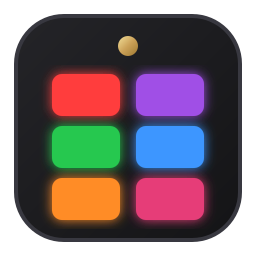

# CasterManager

<p align="center">
  
</p>

<p align="center">
  <strong>Native Linux Desktop Management Suite & Audio Controller for RØDECaster Duo and Pro II</strong>
</p>

<p align="center">
  <a href="#castermanager">English</a> | <a href="#castermanager-español">Español</a>
</p>

<p align="center">
  
  
  
  
</p>

---


## Overview

**CasterManager** is a native, modern, and comprehensive Linux desktop suite created for the **RØDECaster Duo** and **RØDECaster Pro II** audio production consoles. Built on Qt 6 (PyQt6 + QML) with a high-performance Rust protocol bridge (`rcp2-cli`), it delivers a complete management interface matching and extending official desktop utilities: live fader mixing, input routing, SMART Pads customization (sounds & hardware Voice FX), MicroSD recording transfers, and device configuration.

---

## Key Features

### 🎚️ Live Audio Mixer & Fader Control
- **Interactive Multi-Channel Fader Strips:** Real-time bi-directional level synchronization with the console hardware.
- **Physical vs. Virtual Fader Architecture:**
  - Clearly identifies physical hardware sliders (`[FÍSICO]`) and software virtual faders (`[VIRTUAL]`).
  - Allows full interactive control of virtual faders (e.g., SMART Pads audio, Bluetooth, USB Chat) directly from the Linux desktop, updating console levels in real time.
- **Channel Mute & Listen (Solo):** Instant toggle buttons with hardware LED color matching.
- **Input Source Routing Matrix:** Reassign any channel on the fly from the pool of available sources:
  - Neutrik Combo XLR 1 & 2 (with +48V Phantom Power badges)
  - Wireless Series IV dual internal receivers
  - USB 1 Audio Main (Multichannel 24-bit / 48 kHz)
  - USB 2 Audio Chat (automatic mix-minus)
  - Bluetooth Stereo (A2DP & call routing)
  - SMART Pads audio stream
  - TRRS Headset microphone

### 🎛️ SMART Pads Customizer (Sounds & Voice FX)
- **Interactive Matrix View:** 2x3 (Duo) and 2x4 (Pro II) grid layouts across all 8 banks (up to 48 / 64 total pads).
- **Sound Playback Management:**
  - Import audio via file dialog or Drag & Drop (`.wav`, `.mp3`, `.ogg`, `.flac`, `.aac`).
  - Export assigned audio files directly to your PC.
  - Play modes: `Toggle` (play/pause), `One Shot` (complete playback), `Hold` (momentary).
  - Loop, Replay, gain trim (-12 dB to +12 dB), and 12 hardware LED colors.
- **Hardware Voice FX Presets:**
  - Assign native voice effects directly to pads: **Voice Disguise**, **Megaphone**, **Large Robot**, **Pitch Shift**, **Monster**, and **Small Robot**.
  - Target channel selector: route effects to **Mic 1** or **Mic 2**.
  - Trigger mode: **Latch (Toggle)** or **Hold (Momentary)**.
- **Mixer Actions:** Assign hardware Censor Bleep and Ducking functions.

### 🎙️ MicroSD Recording Management & USB Transfer
- **Real-Time Storage Monitoring:** Displays MicroSD capacity, used space, and free space (supports 32 GB, 64 GB, 128 GB, 256 GB+ cards).
- **One-Click USB Mass Storage Mode:** Automatically switches the console to transfer mode and mounts the MicroSD partition (`/dev/sdX1`) in Linux.
- **Podcast Take Browser:** Parses `Meta.xml` metadata for recorded episodes, showing take name, date, time, duration, channel format (Stereo Mix vs. 24-bit Multichannel), and file size.
- **Quick Folder Access:** Open any take folder directly in your default file manager (Dolphin, Nautilus, Nemo, Thunar) with one click.
- **Quick Eject (`⏏`):** Safely unmounts the card and returns the console to live audio mode.

### ⚙️ Hardware & Device Configuration
- **Unified Screen & Button Backlight:** Synchronized brightness sliders controlling both rotary encoder dials and idle/inactive buttons uniformly without delay.
- **Metering Scale Modes:** Switch between **Default** (standard unity gain markers) and **Broadcast** (dBFS precision scale with compressor gain reduction meters).
- **Headphone Profiles:** Configure output impedance and tuning (RØDE NTH-100, High Sensitivity, Low Sensitivity).
- **Audio Routing & Protection:** Auto-mute monitor outputs when faders are raised, auto-mute Bluetooth when mic is live, pre/post-fader listen (PFL/AFL), and multitrack modes.
- **Haptics & USB MIDI:** Enable or adjust tactile vibration and USB MIDI bi-directional communication.

### 🌐 Bilingual Interface & Desktop Polish
- **i18n Support:** Fully translated interface in **English** and **Spanish** with instant switching and persistent `QSettings`.
- **System Desktop Integration:** Complete XDG hicolor icon theme (16x16 up to 256x256 + scalable SVG) and Wayland/X11 taskbar integration.
- **Anti-Freeze Daemon (`castermanager-drain`):** High-performance systemd background daemon that drains USB HID queues continuously, preventing firmware lockups even when the GUI is closed.

---

## Requirements

- **Operating System:** Linux (Arch, Ubuntu, Debian, Fedora, openSUSE, etc.)
- **Python:** 3.10+
- **Qt 6:** `python-pyqt6`, `qt6-declarative` (QML)
- **System Tools:** `udev`, `udisksctl`, `lsblk`

### Package Installation

**Arch Linux / Manjaro:**
```bash
sudo pacman -S python python-pyqt6 qt6-declarative
```

**Ubuntu / Debian / Linux Mint:**
```bash
sudo apt install python3 python3-pyqt6 python3-pyqt6.qtquick
```

**Fedora:**
```bash
sudo dnf install python3 python3-pyqt6 qt6-qtdeclarative
```

---

## Installation

Clone the repository and run the automated installation script:

```bash
git clone https://github.com/ernestoacostame/CasterManager.git
cd CasterManager
./install.sh
```

### What `install.sh` does:
1. Verifies Python 3 and PyQt6 dependencies.
2. Installs `udev` rules (`/etc/udev/rules.d/99-castermanager.rules`) for non-root USB access.
3. Configures kernel module quirks (`/etc/modprobe.d/99-rodecaster-quirks.conf`) to prevent USB HID buffer saturation.
4. Prepares the native backend CLI binary.
5. Installs and enables the background HID drain daemon (`castermanager-drain.service`) in your systemd user session.
6. Installs system icons across all hicolor resolutions and creates the desktop application launcher (`CasterManager`).

---

## Running the Application

Launch CasterManager from your application menu or start it from terminal:

```bash
./run.sh
```

---

## Hardware Compatibility

| Model | Supported | Physical Controls | Virtual Faders | SMART Pads |
| :--- | :---: | :---: | :---: | :---: |
| **RØDECaster Duo** | Yes | 4 Faders, 2 Pots | 2 Software Faders | 6 per bank (2x3) |
| **RØDECaster Pro II** | Yes | 6 Faders, 4 Pots | 3 Software Faders | 8 per bank (2x4) |

---

## Preventing Console Freezes on Linux (The USB HID Quirk)

RØDECaster consoles communicate via USB HID packets. A firmware characteristic causes the device to block indefinitely if an input report write cannot complete when Linux closes or neglects the device handle.

CasterManager solves this with a two-layer approach:
1. **Systemd User Daemon (`castermanager-drain.service`):** Runs continuously in the background, consuming <5 MB of RAM and ~0% CPU, ensuring that incoming HID packets are drained at all times.
2. **Kernel Quirk (`usbhid.quirks`):** For complete kernel-level handling, `/etc/modprobe.d/99-rodecaster-quirks.conf` is installed by `install.sh`. You can also append `usbhid.quirks=0x19f7:0x0093:0x00000400` to your bootloader (e.g., GRUB `GRUB_CMDLINE_LINUX_DEFAULT`).

---

## Support & Donations

If you find **CasterManager** helpful and would like to support its ongoing development, maintenance, and Linux audio hardware support, consider making a donation:

[](https://www.buymeacoffee.com/ernestoacostame)
[](https://ko-fi.com/ernestoacostame)
[](https://www.paypal.com/paypalme/elav)

- ☕ **Buy Me a Coffee:** [buymeacoffee.com/ernestoacostame](https://www.buymeacoffee.com/ernestoacostame)
- 💖 **Ko-fi:** [ko-fi.com/ernestoacostame](https://ko-fi.com/ernestoacostame)
- 🅿️ **PayPal:** [paypal.com/paypalme/elav](https://www.paypal.com/paypalme/elav)

Thank you for your support!

---

## Credits & Acknowledgements

This project was made possible thanks to the work and research of the open-source community:

- **[rcp2-cli](https://github.com/jnbr/rcp2-cli) by jnbr:** Reverse engineering of the RØDECaster Pro II and Duo USB protocol (`rcp2-protocol`, `rcp2-core`), CLI, and mass-storage tooling.
- **The Linux Audio & RØDECaster Reverse Engineering Community:**
  - Community research on `rodecaster-utility` and protocol structures.
  - The [open-caster](https://github.com/) project and Linux driver experimentation.
  - Community work around [rodecaster-control](https://github.com/) and PipeWire routing profiles.

---

## Disclaimer

CasterManager is an independent open-source project and is not affiliated, associated, authorized, endorsed by, or in any way officially connected with RØDE Microphones or Freedman Electronics. All product and company names are trademarks™ or registered® trademarks of their respective holders.

---

## License

This project is licensed under the [MIT License](LICENSE).

---
---

# CasterManager (Español)

<p align="center">
  
</p>

<p align="center">
  <strong>Suite de gestión de escritorio y controlador de audio para RØDECaster Duo y Pro II en Linux</strong>
</p>

<p align="center">
  <a href="#castermanager">English</a> | <a href="#castermanager-español">Español</a>
</p>

<p align="center">
  
  
  
  
</p>

---


## Descripción

**CasterManager** es una suite de escritorio nativa, moderna y completa para Linux, diseñada para las consolas de producción de audio **RØDECaster Duo** y **RØDECaster Pro II**. Construida con Qt 6 (PyQt6 + QML) y respaldada por un puente de protocolo en Rust (`rcp2-cli`), proporciona una suite completa equivalente y superior a las herramientas de escritorio oficiales: mezclador de faders en vivo, matriz de enrutamiento, personalización de SMART Pads (sonidos y efectos de voz por hardware), transferencia de tomas grabadas en la MicroSD y configuración general del hardware.

---

## Características Principales

### 🎚️ Mezclador de Audio en Vivo y Control de Faders
- **Tiras de Fader Interactivas Multicanal:** Sincronización bidireccional en tiempo real con el hardware de la consola.
- **Arquitectura de Faders Físicos vs. Virtuales:**
  - Identificación visual clara entre potenciómetros deslizantes reales (`[FÍSICO]`) y faders virtuales por software (`[VIRTUAL]`).
  - Control interactivo de los faders virtuales (audio de SMART Pads, Bluetooth, USB Chat) directamente desde la pantalla de Linux, moviendo el fader y modificando el volumen real de la consola al instante.
- **Silencio (Mute) y Escucha (Listen / Solo):** Botones con retroiluminación LED sincronizada por hardware.
- **Matriz de Enrutamiento de Entradas:** Asignación de fuentes de entrada a cualquier canal en vivo:
  - Neutrik Combo XLR 1 y 2 (con indicadores de alimentación Phantom +48V)
  - Receptores duales integrados Wireless Series IV (2.4 GHz)
  - Audio USB 1 Principal (Multicanal 24-bit / 48 kHz)
  - Audio USB 2 Chat (con mix-minus automático integrado)
  - Bluetooth Stereo (A2DP y llamadas de voz)
  - Reproductor interno de SMART Pads
  - Micrófono de auriculares Headset TRRS

### 🎛️ Gestor de SMART Pads (Sonidos y Efectos de Voz FX)
- **Matriz Visual Interactiva:** Diseños 2x3 (Duo) y 2x4 (Pro II) en los 8 bancos (hasta 48 o 64 pads en total).
- **Gestión de Pistas de Audio:**
  - Carga mediante selector o Arrastrar y Soltar (`.wav`, `.mp3`, `.ogg`, `.flac`, `.aac`).
  - Exportación directa del archivo de audio del pad hacia tu computadora.
  - Modos de reproducción: `Toggle` (reproducir/pausar), `One Shot` (disparo completo) y `Hold` (mantener presionado).
  - Bucle (`Loop`), reinicio rápido (`Replay`), ganancia (-12 dB a +12 dB) y 12 colores LED oficiales.
- **Efectos de Voz FX por Hardware:**
  - Asignación de efectos de voz nativos del firmware: **Voice Disguise**, **Megaphone**, **Large Robot**, **Pitch Shift**, **Monster** y **Small Robot**.
  - Selector de canal destino: enruta el efecto a **Mic 1** o **Mic 2**.
  - Comportamiento de disparo: **Alternar (Latch)** o **Mantener (Hold)**.
- **Acciones de Mezclador:** Botón de censura (Censor Bleep) y atenuación automática (Ducking).

### 🎙️ Gestor de Grabaciones en MicroSD y Modo Transferencia USB
- **Monitoreo de Almacenamiento en Tiempo Real:** Detección de tarjetas MicroSD (32 GB, 64 GB, 128 GB, 256 GB+), espacio usado y porcentaje disponible.
- **Modo Transferencia de un Clic:** Pone la consola en modo de transferencia USB y monta automáticamente la partición exFAT de la MicroSD (`/dev/sdX1`) en el sistema Linux.
- **Explorador de Tomas Grabadas:** Lee el archivo `Meta.xml` de cada grabación y muestra el nombre del podcast, fecha, hora, duración exacta, formato (Estéreo o Multicanal de 24 bits) y tamaño en disco.
- **Acceso Directo a Archivos:** Botón para abrir la carpeta de la grabación directamente en tu gestor de archivos favorito (Dolphin, Nautilus, Nemo, Thunar).
- **Botón de Expulsión Rápida (`⏏`):** Desmonta la tarjeta y devuelve la consola al modo normal con un solo clic desde la barra lateral.

### ⚙️ Configuración del Dispositivo
- **Brillo Unificado de Pantalla y Botones:** Sliders sin retardo que sincronizan simultáneamente los diales giratorios activos y todos los botones en reposo (Mute, Solo, REC, Pads).
- **Vúmetros (Metering):** Alterna entre **Default** (VU estándar de ganancia unitaria) y **Broadcast** (escala dBFS precisa con reducción de ganancia de compresor).
- **Perfiles de Auriculares:** Ajustes para RØDE NTH-100, alta sensibilidad y baja sensibilidad.
- **Enrutamiento y Protección:** Silenciado automático de monitores al subir faders de micro, silenciado de Bluetooth, escucha pre/post-fader (PFL/AFL) y modos de grabación multitrack.
- **Vibración Háptica y Control MIDI:** Configura la respuesta táctil de los pads y la comunicación MIDI bidireccional por USB.

### 🌐 Soporte Bilingüe e Integración con el Escritorio
- **Idiomas:** Interfaz completa en **Español** e **Inglés**, configurable desde la ventana de ajustes y guardada con persistencia en `QSettings`.
- **Integración XDG:** Icono nativo en todas las resoluciones estándar de `hicolor` (16x16 hasta 256x256 + SVG vectorial) compatible con Wayland y X11.
- **Demonio Anti-Bloqueo (`castermanager-drain`):** Servicio systemd en segundo plano que consume los reportes HID 24/7 con ~0% de CPU, garantizando que el firmware nunca se bloquee.

---

## Requisitos del Sistema

- **Sistema Operativo:** Linux (Arch, Ubuntu, Debian, Fedora, openSUSE, etc.)
- **Python:** 3.10 o superior
- **Qt 6:** `python-pyqt6`, `qt6-declarative` (QML)
- **Herramientas de sistema:** `udev`, `udisksctl`, `lsblk`

### Instalación de Dependencias

**Arch Linux / Manjaro:**
```bash
sudo pacman -S python python-pyqt6 qt6-declarative
```

**Ubuntu / Debian / Linux Mint:**
```bash
sudo apt install python3 python3-pyqt6 python3-pyqt6.qtquick
```

**Fedora:**
```bash
sudo dnf install python3 python3-pyqt6 qt6-qtdeclarative
```

---

## Instalación

Clona el repositorio y ejecuta el script de instalación automática:

```bash
git clone https://github.com/ernestoacostame/CasterManager.git
cd CasterManager
./install.sh
```

### Lo que realiza `install.sh`:
1. Verifica las dependencias de Python 3 y PyQt6.
2. Instala las reglas `udev` (`/etc/udev/rules.d/99-castermanager.rules`) para acceso USB HID sin privilegios de root.
3. Instala los quirks de kernel (`/etc/modprobe.d/99-rodecaster-quirks.conf`) para prevenir saturación de buffers.
4. Prepara el binario del backend CLI (`bin/rcp2-cli`).
5. Registra, habilita e inicia el servicio en segundo plano (`castermanager-drain.service`) en systemd.
6. Instala los iconos de la aplicación en el tema estándar del sistema (`hicolor`) y crea el lanzador de escritorio (`CasterManager`).

---

## Ejecución

Puedes abrir CasterManager desde el menú de aplicaciones de tu entorno (KDE Plasma, GNOME, etc.) o por terminal con:

```bash
./run.sh
```

---

## Compatibilidad de Hardware

| Modelo | Soportado | Controles Físicos | Faders Virtuales | SMART Pads |
| :--- | :---: | :---: | :---: | :---: |
| **RØDECaster Duo** | Sí | 4 Faders, 2 Pots | 2 Faders Virtuales | 6 por banco (2x3) |
| **RØDECaster Pro II** | Sí | 6 Faders, 4 Pots | 3 Faders Virtuales | 8 por banco (2x4) |

---

## Prevención de Bloqueos en Linux (USB HID Quirk)

Las consolas RØDECaster se comunican mediante paquetes USB HID. Una particularidad de su firmware hace que la consola se bloquee indefinidamente si intenta enviar reportes y el host cierra la lectura del dispositivo.

CasterManager soluciona este problema mediante dos capas:
1. **Servicio Systemd de Usuario (`castermanager-drain.service`):** Corre silenciosamente en segundo plano, asegurando que los reportes de progreso y estado sean consumidos en todo momento sin afectar el rendimiento.
2. **Quirk de Módulo de Kernel (`usbhid.quirks`):** Para soporte nativo a nivel de kernel, `install.sh` instala `/etc/modprobe.d/99-rodecaster-quirks.conf`. También puedes añadir `usbhid.quirks=0x19f7:0x0093:0x00000400` a la línea de comandos de GRUB (`GRUB_CMDLINE_LINUX_DEFAULT`).

---

## Apoyo y Donaciones

Si encuentras útil **CasterManager** y te gustaría apoyar su desarrollo continuo, mantenimiento y soporte de hardware de audio en Linux, puedes considerar hacer una donación:

[](https://www.buymeacoffee.com/ernestoacostame)
[](https://ko-fi.com/ernestoacostame)
[](https://www.paypal.com/paypalme/elav)

- ☕ **Buy Me a Coffee:** [buymeacoffee.com/ernestoacostame](https://www.buymeacoffee.com/ernestoacostame)
- 💖 **Ko-fi:** [ko-fi.com/ernestoacostame](https://ko-fi.com/ernestoacostame)
- 🅿️ **PayPal:** [paypal.com/paypalme/elav](https://www.paypal.com/paypalme/elav)

¡Muchas gracias por tu apoyo!

---

## Créditos y Agradecimientos

Este proyecto es posible gracias al trabajo previo y a la investigación de la comunidad open-source:

- **[rcp2-cli](https://github.com/jnbr/rcp2-cli) por jnbr:** Extraordinaria ingeniería inversa del protocolo USB de RØDECaster Pro II y Duo (`rcp2-protocol`, `rcp2-core`), CLI y utilidades de almacenamiento eMMC.
- **Comunidad de Audio y Reverse Engineering de RØDECaster en Linux:**
  - Investigación de la comunidad en `rodecaster-utility`.
  - El proyecto [open-caster](https://github.com/) y experimentación con controladores Linux.
  - El trabajo comunitario en [rodecaster-control](https://github.com/) y perfiles de enrutamiento PipeWire.

---

## Descargo de Responsabilidad (Disclaimer)

CasterManager es un proyecto de código abierto independiente y no está afiliado, asociado, autorizado ni respaldado de ninguna manera por RØDE Microphones ni Freedman Electronics. Todos los nombres de productos y marcas comerciales pertenecen a sus respectivos propietarios.

---

## Licencia

Este proyecto está distribuido bajo la licencia [MIT](LICENSE).
